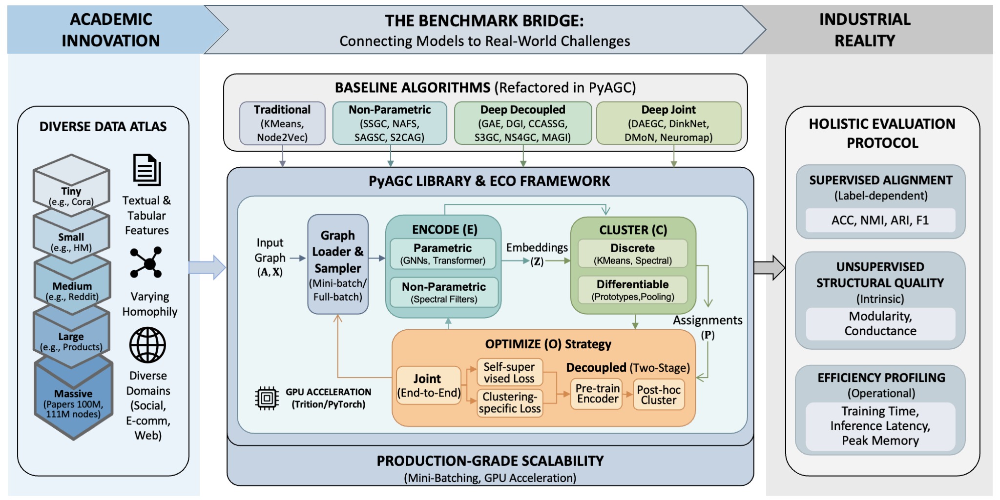

<div align="center">
  
  <h1>Bridging Academia and Industry for Attributed Graph Clustering</h1>
  <p>
    <a href="https://pypi.org/project/PyAGC"></a>
    <a href="https://pyagc.readthedocs.io"></a>
    <a href="https://github.com/Cloudy1225/PyAGC/blob/main/LICENSE"></a>
    <a href="https://arxiv.org/abs/2602.08519"></a>
    <a href="https://github.com/Cloudy1225/PyAGC"></a>
  </p>
  <p>
    <a href="README.md"><strong>English</strong></a> |
    <a href="https://arxiv.org/abs/2602.08519"><strong>基准论文（NeurIPS 2026）</strong></a> |
    <a href="https://arxiv.org/abs/2603.20829"><strong>综述论文</strong></a> |
    <a href="https://pyagc.readthedocs.io"><strong>文档</strong></a> |
    <a href="https://pypi.org/project/pyagc"><strong>PyPI</strong></a> |
    <a href="benchmark/results/"><strong>基准结果</strong></a> |
    <a href="AWESOME_AGC.md"><strong>论文收集</strong></a>
  </p>
  <p>
    <a href="https://www.nju.edu.cn/"></a>
    &nbsp;&nbsp;&nbsp;&nbsp;
    <a href="https://www.antgroup.com/"></a>
  </p>
</div>

**PyAGC** 是面向**属性图聚类（Attributed Graph Clustering, AGC）**的模块化算法库与系统化基准，基于 [PyTorch](https://pytorch.org) 与 [PyTorch Geometric](https://www.pyg.org/) 构建。它在统一的 **编码—聚类—优化（Encode-Cluster-Optimize, ECO）** 框架下整合了 20 余种前沿算法，提供可在单张 32GB GPU 上扩展到 **1.11 亿节点**的 mini-batch 实现，并在 **12 个差异化数据集**上给出覆盖有监督、无监督与效率指标的整体评测协议。

PyAGC 已在**蚂蚁集团**的高风险业务流中经过验证，覆盖欺诈检测、反洗钱与用户画像。它为社区提供一个稳健、可复现、可扩展的平台，推动属性图聚类研究走向真实部署。

<div align="center">
  
</div>

---

## 动态

- **[2026-09-25]** 基准论文被 **NeurIPS 2026 Evaluations & Datasets** 录用！[[arXiv]](https://arxiv.org/abs/2602.08519)
- **[2026-03-24]** 综述论文发布于 [arXiv](https://arxiv.org/abs/2603.20829)。
- **[2026-03-02]** 新增 [AGC 论文列表](AWESOME_AGC.md)，整理属性图聚类相关论文。
- **[2026-02-10]** 基准论文发布于 [arXiv](https://arxiv.org/abs/2602.08519)。
- **[2026-02-09]** PyAGC 首次发布。

---

## 目录

- [为什么需要 PyAGC](#为什么需要-pyagc)
- [主要特性](#主要特性)
- [项目结构](#项目结构)
- [安装](#安装)
- [快速开始](#快速开始)
- [ECO 框架](#eco-框架)
- [基准评测](#基准评测)
  - [数据集](#数据集)
  - [算法](#算法)
  - [评测协议](#评测协议)
  - [基准结果](#基准结果)
  - [可复现性](#可复现性)
- [使用方式](#使用方式)
  - [运行基准](#运行基准)
  - [自定义实验](#自定义实验)
  - [扩展到大规模图](#扩展到大规模图)
- [扩展 PyAGC](#扩展-pyagc)
- [AGC 论文列表](#agc-论文列表)
- [常见问题](#常见问题)
- [引用](#引用)
- [参与贡献](#参与贡献)
- [许可证](#许可证)
- [致谢](#致谢)

---

## 为什么需要 PyAGC

当前属性图聚类评测存在四个关键局限，PyAGC 针对这些问题而设计：

| 问题 | 现状 | PyAGC 的做法 |
|:--|:--|:--|
| **数据集的 Cora 化** | 过度依赖小规模、高同配的引文网络 | 12 个数据集，规模跨 5 个数量级，包含带表格特征、低同配性的工业图 |
| **可扩展性瓶颈** | 全图训练通常只能处理约 10⁵ 个节点 | Mini-batch 实现，单张 32GB GPU 可训练 1.11 亿以上节点 |
| **有监督指标悖论** | 无监督方法只用有监督指标评测 | 同时报告无监督结构指标（模块度、导率）与效率画像 |
| **可复现性缺口** | 代码分散，超参数硬编码 | 统一、由配置驱动的框架，实验由 YAML 严格管理 |

---

## 主要特性

- 📊 **多样的数据集** — 12 张图，节点规模从 2.7K 到 1.11 亿，覆盖引文、社交、电商与网页，同时包含文本特征与表格特征，同配性差异明显。

- 🧩 **统一的算法框架** — 20 余种前沿方法按编码—聚类—优化分类组织，编码器、聚类头与优化策略可替换。

- 📏 **整体评测协议** — 有监督指标（ACC、NMI、ARI、F1）、无监督结构指标（模块度、导率），以及时间与显存的效率画像。

- 🚀 **面向生产规模的扩展能力** — 基于 PyTorch 与 Triton 的 GPU 加速 KMeans，以及基于邻居采样的 mini-batch 训练，可在单张 32GB V100 上将深度聚类扩展到 1.11 亿节点。

- 🛠️ **便于开发** — 组件可插拔，配置由 YAML 驱动。原型新方法时，往往只需改配置中的一行。

- 📚 **论文精选** — 配套的 [AGC 论文列表](AWESOME_AGC.md) 覆盖综述、基准与属性图聚类最新研究。

---

## 项目结构

```
PyAGC/
├── pyagc/                          # 核心库
│   ├── encoders/                   # GNN 骨干（GCN、GAT、SAGE、GIN、Transformers）
│   ├── clusters/                   # 聚类头（KMeans、DEC、DMoN、MinCut、Neuromap 等）
│   ├── models/                     # 完整模型实现（20 余种方法）
│   ├── data/                       # 统一数据加载
│   ├── metrics/                    # 有监督与无监督指标
│   ├── transforms/                 # 图增强（丢边、特征掩码）
│   └── utils/                      # 检查点、日志及其他工具
├── benchmark/                      # 可复现实验
│   ├── <Method>/                   # 每个方法一个目录
│   │   ├── main.py                 # 入口
│   │   ├── train.conf.yaml         # 超参数配置
│   │   └── logs/                   # 各数据集的实验日志
│   ├── data/                       # 缓存的数据集
│   └── results/                    # 汇总后的基准结果
├── AWESOME_AGC.md                  # AGC 论文列表
├── tests/                          # 单元测试
└── docs/                           # 文档（Sphinx → Read the Docs）
```

---

## 安装

### 从 PyPI 安装（推荐）

```bash
pip install pyagc
```

### 从源码安装

```bash
git clone https://github.com/Cloudy1225/PyAGC.git
cd PyAGC
pip install -e .
```

### 环境要求

- Python >= 3.10
- PyTorch >= 2.6.0
- PyTorch Geometric >= 2.7.0

---

## 快速开始

```python
import torch
from torch_geometric.data import Data
from pyagc.data import get_dataset
from pyagc.encoders import GCN
from pyagc.models import DGI
from pyagc.clusters import KMeansClusterHead
from pyagc.metrics import label_metrics, structure_metrics

# 1. 加载数据集
x, edge_index, y = get_dataset('Cora', root='data/')
data = Data(x=x, edge_index=edge_index, y=y)
device = torch.device('cuda' if torch.cuda.is_available() else 'cpu')

# 2. 构建模型（编码 + 优化）
encoder = GCN(in_channels=data.num_features, hidden_channels=512, num_layers=1)
model = DGI(hidden_channels=512, encoder=encoder).to(device)

# 3. 训练编码器
data = data.to(device)
optimizer = torch.optim.Adam(model.parameters(), lr=0.001)
for epoch in range(200):
    loss = model.train_full(data, optimizer, epoch, verbose=(epoch % 50 == 0))

# 4. 聚类（聚类投影）
model.eval()
with torch.no_grad():
    z = model.infer_full(data)

n_clusters = int(y.max().item()) + 1
kmeans = KMeansClusterHead(n_clusters=n_clusters)
clusters = kmeans.fit_predict(z)

# 5. 评测：有监督 + 无监督
sup = label_metrics(y, clusters, metrics=['ACC', 'NMI', 'ARI', 'F1'])
unsup = structure_metrics(edge_index, clusters, metrics=['Mod', 'Cond'])
print(f"ACC: {sup['ACC']:.4f} | NMI: {sup['NMI']:.4f} | ARI: {sup['ARI']:.4f}")
print(f"Modularity: {unsup['Mod']:.4f} | Conductance: {unsup['Cond']:.4f}")
```

---

## ECO 框架

PyAGC 用统一的 **编码—聚类—优化（ECO）** 框架组织属性图聚类算法。该框架在[综述论文](https://arxiv.org/abs/2603.20829)中正式提出：

```
                    ┌────────────────────────────────────────────────────┐
                    │              Encode-Cluster-Optimize               │
                    │                                                    │
  (A, X) ──────►    │  ┌──────────┐    ┌───────────┐    ┌────────────┐   │ ──────► 聚类结果
                    │  │ Encoder  │───►│ Cluster   │◄──►│ Optimizer  │   │
                    │  │   (E)    │    │ Head (C)  │    │    (O)     │   │
                    │  └──────────┘    └───────────┘    └────────────┘   │
                    └────────────────────────────────────────────────────┘
```

| 模块 | 选项 | 例子 |
|:-------|:--------|:---------|
| **编码器 Encoder** | 参数化 | GCN、GAT、GraphSAGE、GIN、SGFormer、Polynormer |
| | 非参数 | 固定图滤波器、自适应平滑、马尔可夫扩散 |
| **聚类头 Cluster** | 可微 | Softmax 池化（DMoN、MinCut、Neuromap），基于原型（DEC、DinkNet） |
| | 离散（后处理） | KMeans、谱聚类、子空间聚类 |
| **优化器 Optimizer** | 联合 | 端到端：自监督损失 + 聚类专用损失 |
| | 解耦 | 先预训练编码器，再做离散聚类 |

这种拆分让实验可以插拔组合。例如在 DAEGC 中把 GCN 编码器换成 GAT，只需改配置文件中的一行。ECO 框架的理论分析以及属性图聚类的工业视角，见[综述论文](https://arxiv.org/abs/2603.20829)。

---

## 基准评测

### 数据集

基准收录 **12 个数据集**，规模跨 5 个数量级，并覆盖不同领域、特征模态与同配水平：

| 规模 | 数据集 | 领域 | 节点数 | 边数 | 平均度 | 特征维 | 特征类型 | 簇数 | $\mathcal{H}_e$ | $\mathcal{H}_n$ |
| :------ | :------------- | :---------- | :---------- | :------------ | :-------- | :----- | :---------- | :-------- | :-------------- | :-------------- |
| 微型 | **Cora** | 引文 | 2,708 | 10,556 | 3.9 | 1,433 | 文本 | 7 | 0.81 | 0.83 |
| 微型 | **Photo** | 共同购买 | 7,650 | 238,162 | 31.1 | 745 | 文本 | 8 | 0.83 | 0.84 |
| 小型 | **Physics** | 合作者 | 34,493 | 495,924 | 14.4 | 8,415 | 文本 | 5 | 0.93 | 0.92 |
| 小型 | **HM** | 共同购买 | 46,563 | 21,461,990 | 460.9 | 120 | **表格** | 21 | 0.16 | 0.35 |
| 小型 | **Flickr** | 社交 | 89,250 | 899,756 | 10.1 | 500 | 文本 | 7 | 0.32 | 0.32 |
| 中型 | **ArXiv** | 引文 | 169,343 | 1,166,243 | 6.9 | 128 | 文本 | 40 | 0.65 | 0.64 |
| 中型 | **Reddit** | 社交 | 232,965 | 23,213,838 | 99.6 | 602 | 文本 | 41 | 0.78 | 0.81 |
| 中型 | **MAG** | 引文 | 736,389 | 10,792,672 | 14.7 | 128 | 文本 | 349 | 0.30 | 0.31 |
| 大型 | **Pokec** | 社交 | 1,632,803 | 44,603,928 | 27.3 | 56 | **表格** | 183 | 0.43 | 0.39 |
| 大型 | **Products** | 共同购买 | 2,449,029 | 61,859,140 | 25.4 | 100 | 文本 | 47 | 0.81 | 0.82 |
| 大型 | **WebTopic** | 网页 | 2,890,331 | 24,754,822 | 8.6 | 528 | **表格** | 28 | 0.22 | 0.24 |
| 超大规模 | **Papers100M** | 引文 | 111,059,956 | 1,615,685,872 | 14.5 | 128 | 文本 | 172 | 0.57 | 0.50 |

**多样性主要体现在：**

- **规模**：5 个数量级（2.7K → 1.11 亿节点）
- **属性**：文本（词袋、嵌入）与表格（类别 + 数值）
- **结构**：从高同配（Physics，$\mathcal{H}_e$=0.93）到异配（HM，$\mathcal{H}_e$=0.16）
- **领域**：引文、共同购买、合作者、社交网络、网页图

### 算法

#### 传统方法

| 方法 | 出处 | 编码器 | 聚类器 | 优化方式 |
| :--------------------------------------------------------- | :----- | :------------------ | :---------------- | :----------- |
| [KMeans](https://en.wikipedia.org/wiki/K-means_clustering) | — | 无（原始特征） | 离散（KMeans） | 解耦 |
| [Node2Vec](https://arxiv.org/abs/1607.00653) | KDD'16 | 随机游走 | 离散（KMeans） | 解耦 |

#### 非参数方法

| 方法 | 出处 | 编码器 | 聚类器 | 优化方式 |
| :----------------------------------------------------------- | :------ | :-------------- | :------------------ | :----------- |
| [SSGC](https://openreview.net/forum?id=CYO5T-YjWZV) | ICLR'21 | 自适应滤波 | 离散（KMeans） | 解耦 |
| [SAGSC](https://ojs.aaai.org/index.php/AAAI/article/view/25918) | AAAI'23 | 固定滤波 | 离散（子空间） | 解耦 |
| [MS2CAG](https://arxiv.org/abs/2411.11074) | KDD'25 | 固定滤波 | 离散（SNEM） | 解耦 |

#### 深度解耦方法

| 方法 | 出处 | 编码器 | 聚类器 | 核心目标 |
| :----------------------------------------------------------- | :----------- | :------ | :-------- | :---------------------------- |
| [GAE](https://arxiv.org/abs/1611.07308) | NeurIPS-W'16 | GCN | KMeans | 图重构 |
| [DGI](https://arxiv.org/abs/1809.10341) | ICLR'19 | GCN | KMeans | 互信息最大化 |
| [CCASSG](https://arxiv.org/abs/2106.12484) | NeurIPS'21 | GCN | KMeans | 冗余削减 |
| [S3GC](https://proceedings.neurips.cc/paper_files/paper/2022/hash/15972a9575e0f03bf82f00aebeb40774-Abstract-Conference.html) | NeurIPS'22 | GCN | KMeans | 对比学习（随机游走） |
| [NS4GC](https://arxiv.org/abs/2408.03765) | TKDE'24 | GCN | KMeans | 对比学习（节点相似度） |
| [SCGC](https://arxiv.org/abs/2205.07865) | TNNLS'23 | GCN | KMeans | 对比学习（结构 MSE） |
| [MAGI](https://arxiv.org/abs/2406.14288) | KDD'24 | GNN | KMeans | 对比学习（模块度） |

#### 深度联合方法

| 方法 | 出处 | 编码器 | 聚类器 | 核心目标 |
| :----------------------------------------------------------- | :--------- | :------ | :-------------- | :----------------------- |
| [DAEGC](https://arxiv.org/abs/1906.06532) | IJCAI'19 | GAT | 原型（DEC） | 重构 + KL 散度 |
| [MinCut](https://proceedings.mlr.press/v119/bianchi20a.html) | ICML'20 | GCN | Softmax | 割最小化 |
| [DMoN](https://jmlr.org/papers/v24/20-998.html) | JMLR'23 | GCN | Softmax | 模块度最大化 |
| [DinkNet](https://proceedings.mlr.press/v202/liu23v.html) | ICML'23 | GCN | 原型 | 膨胀 + 收缩损失 |
| [Neuromap](https://arxiv.org/abs/2310.01144) | NeurIPS'24 | GCN | Softmax | Map Equation |

### 评测协议

我们主张**整体评测**，而不只依赖常见的有监督指标：

#### 有监督对齐指标

在有真实标签时，衡量与标签的一致性：

- **ACC** — 聚类准确率（经匈牙利算法最优匹配）
- **NMI** — 归一化互信息
- **ARI** — 调整兰德指数
- **Macro-F1** — 宏平均 F1

#### 无监督结构指标

不依赖标签评估簇的内在质量，这对真实部署很关键：

- **Modularity（模块度）** — 簇内边密度相对随机期望的强弱（越高越好）
- **Conductance（导率）** — 指向簇外的边流量占比（越低越好）

#### 效率画像

- 训练时间、推理延迟、GPU 峰值显存

```python
from pyagc.metrics import label_metrics, structure_metrics

# 有监督
sup = label_metrics(y_true, y_pred, metrics=['ACC', 'NMI', 'ARI', 'F1'])

# 无监督
unsup = structure_metrics(edge_index, y_pred, metrics=['Mod', 'Cond'])
```

### 基准结果

完整指标见 [`benchmark/results/`](benchmark/results/) 与论文。

> 📋 ACC、ARI、F1、模块度、导率、训练时间与 GPU 显存的完整结果，见[结构化结果](benchmark/results/Structured%20Benchmark%20Results.md)与[非结构化结果](benchmark/results/Unstructured%20Benchmark%20Results.md)。

### 可复现性

所有实验都可以通过配置文件复现：

```bash
# 复现基准结果
cd benchmark/DMoN
python main.py --config train.conf.yaml --dataset Cora --seed 0
python main.py --config train.conf.yaml --dataset Cora --seed 1
python main.py --config train.conf.yaml --dataset Cora --seed 2
python main.py --config train.conf.yaml --dataset Cora --seed 3
python main.py --config train.conf.yaml --dataset Cora --seed 4
```

每次运行会在 `logs/<Dataset>/<method>/` 下生成带时间戳的日志，内容包括：

- 全部超参数
- 训练损失曲线
- 最终指标（有监督 + 无监督）
- 运行时间与显存统计

---

## 使用方式

### 运行基准

每个算法都有独立目录，内含 `main.py` 与 YAML 配置：

```bash
# 在 Cora 上运行 DMoN
cd benchmark/DMoN
python main.py --config train.conf.yaml --dataset Cora

# 在 Reddit 上运行 DAEGC（mini-batch）
cd benchmark/DAEGC
python main.py --config train.conf.yaml --dataset Reddit
```

结果会自动写入 `benchmark/<Method>/logs/<Dataset>/`。

### 自定义实验

模块化设计便于组合新方法：

```python
from pyagc.encoders import GCN, GAT
from pyagc.models import DMoN

# 把 DMoN 中的 GCN 换成 GAT，只需改一行
encoder = GAT(in_channels=1433, hidden_channels=256, num_layers=2)
model = DMoN(encoder=encoder, n_features=256, n_clusters=7)
```

也可以直接改 YAML：

```yaml
encoder:
  type: GAT            # 由 GCN 改为 GAT
  hidden_channels: 256
  num_layers: 2
cluster:
  type: DMoN
  n_clusters: 7
```

### 扩展到大规模图

PyAGC 通过 mini-batch 邻居采样，在超大规模图上训练：

```python
from torch_geometric.loader import NeighborLoader

# 构建 mini-batch 加载器
loader = NeighborLoader(
    data,
    num_neighbors=[15, 10],
    batch_size=1024,
    shuffle=True,
)

# Mini-batch 训练循环
for batch in loader:
    batch = batch.to(device)
    loss = model.train_mini_batch(batch, optimizer)
```

> **规模说明**：复杂模型（如 DAEGC）可以在单张 32GB V100 上训练 **Papers100M（1.11 亿节点、16 亿边）**，耗时不超过 2 小时。

---

## 扩展 PyAGC

### 添加新编码器

```python
from pyagc.encoders import GCN

# 使用任意与 PyG 兼容的编码器
encoder = GCN(
    in_channels=128,
    hidden_channels=256,
    num_layers=3,
    dropout=0.1
)

# 接入任意模型
model = DMoN(encoder=encoder, n_clusters=7)
```

### 添加新聚类头

```python
# pyagc/clusters/my_cluster_head.py
from pyagc.clusters import BaseClusterHead

class MyClusterHead(BaseClusterHead):
    def __init__(self, n_clusters, in_channels):
        super().__init__(n_clusters)
        # 定义可学习参数
        ...

    def forward(self, *args, **kwargs):
        # 返回聚类损失
        ...
        return loss

    def cluster(self, z, soft=True):
        # 返回形状为 [N, K] 的软分配矩阵 P
        ...
        return p
```

### 添加新模型

```python
# pyagc/models/my_model.py
from pyagc.models import BaseModel

class MyModel(BaseModel):
    def __init__(self, encoder, cluster_head):
        super().__init__()
        self.encoder = encoder
        self.cluster_head = cluster_head

    def forward(self, data):
        z = self.encoder(data.x, data.edge_index)
        return z

    def loss(self, data):
        z = self.forward(data)
        rep_loss = ...       # 表示学习损失
        clust_loss = self.cluster_head(z, data.edge_index)
        return rep_loss + self.lambda_ * clust_loss
```

---

## AGC 论文列表

我们维护一份属性图聚类阅读清单，覆盖综述、基准与最新方法，并与 PyAGC 基准相互补充。

📄 **[查看完整论文列表 →](AWESOME_AGC.md)**

### 精选

| 类别 | 代表工作 |
|:---------|:--------------|
| **综述与基准** | [Beyond the Academic Monoculture（本文综述）](https://arxiv.org/abs/2603.20829)、[A Survey of Deep Graph Clustering](https://arxiv.org/abs/2211.12875)、[DGCBench](https://openreview.net/forum?id=dKVUUZfcW9)、[PyAGC Benchmark（NeurIPS 2026）](https://arxiv.org/abs/2602.08519) |
| **非参数** | [SSGC (ICLR'21)](https://openreview.net/forum?id=CYO5T-YjWZV)、[SAGSC (AAAI'23)](https://ojs.aaai.org/index.php/AAAI/article/view/25918)、[MS2CAG (KDD'25)](https://arxiv.org/abs/2411.11074) |
| **深度解耦** | [DGI (ICLR'19)](https://arxiv.org/abs/1809.10341)、[S3GC (NeurIPS'22)](https://proceedings.neurips.cc/paper_files/paper/2022/hash/15972a9575e0f03bf82f00aebeb40774-Abstract-Conference.html)、[MAGI (KDD'24)](https://arxiv.org/abs/2406.14288) |
| **深度联合** | [DMoN (JMLR'23)](https://jmlr.org/papers/v24/20-998.html)、[DinkNet (ICML'23)](https://proceedings.mlr.press/v202/liu23v.html)、[Neuromap (NeurIPS'24)](https://arxiv.org/abs/2310.01144) |

> 💡 发现应收录的论文？欢迎向 [`AWESOME_AGC.md`](AWESOME_AGC.md) 提交 PR。

---

## 常见问题

<details>
<summary><b>问：如何在自己的图上做实验？</b></summary>

1. 把图整理为 PyTorch Geometric 的 `Data` 对象，包含 `x`（节点特征）、`edge_index`（边列表），评测时可选 `y`（标签）。
2. 从 `pyagc.models` 选择模型，并搭配自己的编码器与聚类头。
</details>

<details>
<summary><b>问：没有真实标签也能用吗？</b></summary>

可以，这正是 PyAGC 的核心使用场景。通过 `pyagc.metrics.structure_metrics` 使用无监督结构指标（模块度、导率），在没有标签时评估聚类质量。
</details>

<details>
<summary><b>问：图聚类的 mini-batch 训练如何工作？</b></summary>

我们使用 PyTorch Geometric 的 `NeighborLoader` 做邻居采样，构造计算子图。编码器在这些子图上前向，损失在 mini-batch 上近似。这样 GPU 显存与全图规模解耦，单卡即可训练 1 亿以上节点的图。
</details>

<details>
<summary><b>问：需要什么 GPU？</b></summary>

全部基准实验在单张 NVIDIA Tesla V100（32GB）上完成。小规模与中等规模数据集，8–16GB 显存通常足够。Papers100M 建议至少 32GB 显存。
</details>

---

## 引用

如果 PyAGC 对你的研究有帮助，请引用以下论文：

```bibtex
@inproceedings{liu2026bridging,
  title={Bridging Academia and Industry: A Comprehensive Benchmark for Attributed Graph Clustering},
  author={Yunhui Liu and Pengyu Qiu and Yu Xing and Yongchao Liu and Peng Du and Chuntao Hong and Jiajun Zheng and Tao Zheng and Tieke He},
  booktitle={The Fortieth Annual Conference on Neural Information Processing Systems Evaluations and Datasets Track},
  year={2026},
  url={https://openreview.net/forum?id=qBpyipVo0p}
}

@article{liu2026beyond,
  title={Beyond the Academic Monoculture: A Unified Framework and Industrial Perspective for Attributed Graph Clustering},
  author={Yunhui Liu and Yue Liu and Yongchao Liu and Tao Zheng and Stan Z. Li and Xinwang Liu and Tieke He},
  year={2026},
  eprint={2603.20829},
  archivePrefix={arXiv},
  primaryClass={cs.LG}
}

@article{liu2026towards,
  title={Towards One-for-All Foundation Model for Attributed Graph Clustering}, 
  author={Yunhui Liu and Xudong Jin and Kang Zhang and Danshuo An and Yu Xing and Te Song and Jia Liu and Tieke He},
  year={2026},
  eprint={2610.07778},
  archivePrefix={arXiv},
  primaryClass={cs.LG}
}

@article{liu2024reliable,
  title={Reliable node similarity matrix guided contrastive graph clustering},
  author={Liu, Yunhui and Gao, Xinyi and He, Tieke and Zheng, Tao and Zhao, Jianhua and Yin, Hongzhi},
  journal={IEEE Transactions on Knowledge and Data Engineering},
  volume={36},
  number={12},
  pages={9123--9135},
  year={2024},
  publisher={IEEE}
}
```

---

## 参与贡献

欢迎贡献。开发环境，以及如何添加方法、数据集或论文，见 [CONTRIBUTING.zh-CN.md](CONTRIBUTING.zh-CN.md)。

---

## 许可证

PyAGC 以 [MIT 许可证](LICENSE) 发布。

---

## 致谢

PyAGC 建立在以下开源生态之上：

- [PyTorch](https://pytorch.org)
- [PyTorch Geometric](https://www.pyg.org/)
- [Open Graph Benchmark](https://ogb.stanford.edu/)
- [GraphLand](https://github.com/yandex-research/graphland)

感谢蚂蚁集团对这一基准工业验证的支持。

---

<p align="center">
  <a href="https://github.com/Cloudy1225/PyAGC">GitHub</a> · <a href="https://pypi.org/project/PyAGC">PyPI</a> · <a href="https://pyagc.readthedocs.io">文档</a> · <a href="https://arxiv.org/abs/2602.08519">基准论文</a> · <a href="https://arxiv.org/abs/2603.20829">综述论文</a> · <a href="AWESOME_AGC.md">AGC 论文列表</a>
  <br>
  Made with ❤️ for the Graph ML Community
</p>
